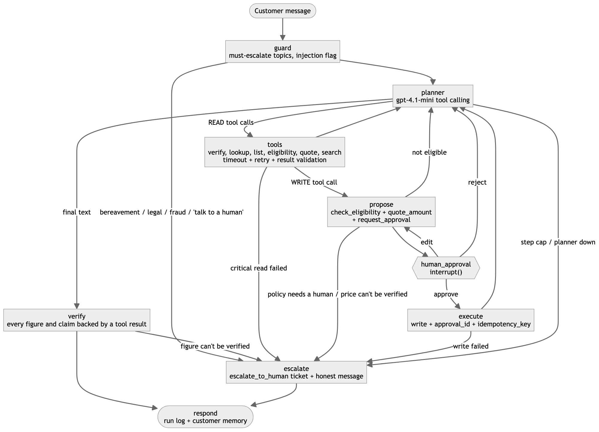
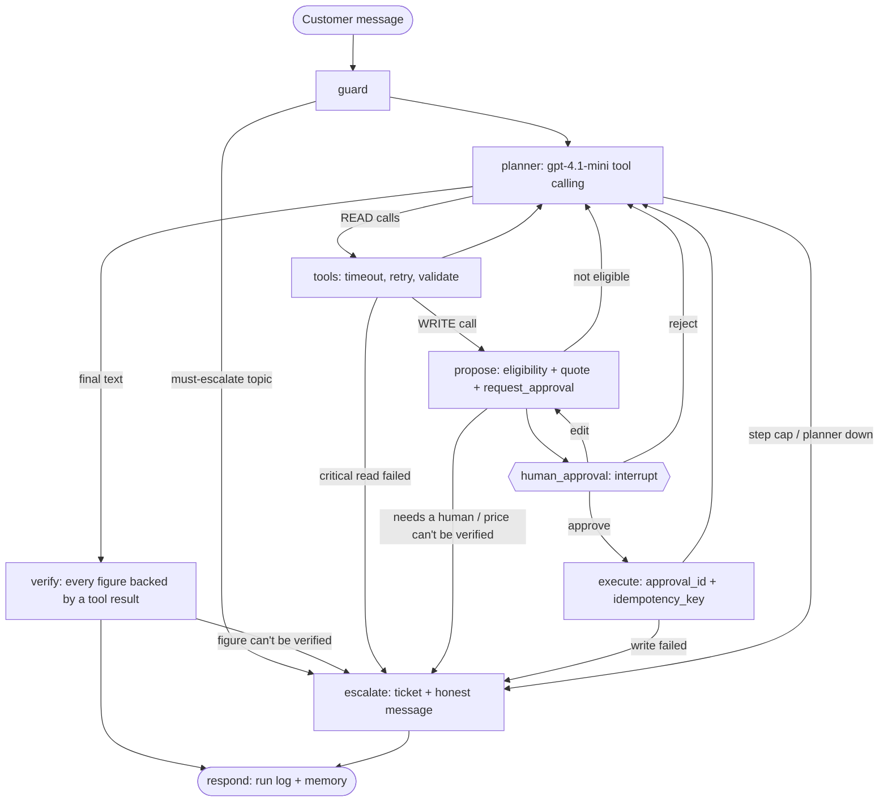

# SkyDesk Support Agent

A customer-support **agent** for the fictional airline SkyDesk. It resolves booking requests end to end:
it verifies the customer, looks up the booking, checks eligibility against policy rules written as code,
quotes exact amounts from deterministic calculations, and proposes the change. The change then **pauses for
human approval**. After approval it executes, and it only reports what the backend confirmed. When policy says
a person must decide, or when it can't proceed safely, it hands the case to a human.

The Gen Academy, Mastering Agentic AI, **Week 3: Build Your AI Agent**. Track 2 (LangChain + LangGraph),
bring-your-own use case. It builds on the Week 2 SkyDesk help-center RAG (`rag/`, `corpus/`).

> **Status (2026-10-25).** Evaluated with the **real gpt-4.1-mini planner**: 24 scenarios × 2 passes,
> **23/24 tasks completed in each pass, 0 unsafe writes**, median agent time 3.5–3.7 s per task, about
> $0.003 per task. **383 tests pass with no API calls.** Total OpenAI spend for the project, from the cost
> ledger: **$0.511** (819 calls, incl. the demo video and a final validation run) of the $1.00 cap. Development first ran on a $0 keyword baseline
> planner while the old key was dead; those numbers are kept only as history in the eval report.

## Week 3 submission

| Deliverable | Where |
|---|---|
| Project documentation | [`docs/PROJECT_DOC.md`](docs/PROJECT_DOC.md), also as a Word file built from it: `submission/SkyDesk_Support_Agent_Week3.docx` (paste into the Google Doc) |
| Video demo (≤ 5 min) | Submitted via Google Drive (the link is in the form) |
| Code base | This repository |
| Requirement-by-requirement check | [`docs/COMPLIANCE.md`](docs/COMPLIANCE.md) |
| Evaluation report | [`docs/EVAL_REPORT.md`](docs/EVAL_REPORT.md) |

## One-liner

> My agent helps **a SkyDesk customer** do **a booking change (refund, cancellation, rebooking, delay
> compensation, fee waiver or contact update)** in **the chat widget on the SkyDesk website**, replacing **a
> call or email to the contact center, where an agent looks up the booking, reads the fare rules, works out
> the amount by hand and waits for a supervisor's sign-off (minutes to days per request)**. It verifies the
> customer, looks up the booking, checks policy and quotes the exact amount on its own using **13 tools (6
> read, 6 write, 1 hand-off)**. It hands off to a human **before every write (approve, edit or reject), and
> for bereavement, legal or fraud cases, or whenever a system it needs fails or a price can't be verified**.
> I'll know it works when **a customer** can **finish the request** in **under 2 minutes** with **at least 20
> of the 24 eval scenarios completed end to end and 0 writes without approval**.
>
> *Measured with gpt-4.1-mini (24 scenarios × 2 passes):* **task completion 23/24 (96%) in each pass**, 0
> unsafe writes out of 10, approval coverage 1.00. **Time per task:** median 3.5–3.7 s of agent time
> (slowest 7.3 s), p50 2.8–3.1 s and p95 4.7–4.9 s per turn, so the 2-minute target is spent on the customer
> typing and the supervisor approving, not on the agent. The 2-minute end-to-end time has not been timed
> with real users.

## Agent framework

| Field | SkyDesk Support Agent |
|---|---|
| **Agent goal** | Take a customer's booking request and resolve it end to end: verify, look up, check policy, quote, get a human's approval for any change, execute, and confirm truthfully. |
| **Where people use it** | A chat widget docked on the SkyDesk airline website (`web/`, served on port 9009). Approvers use the approval card or the `/supervisor` page. There is also a terminal CLI (`python -m skydesk chat`). |
| **Steps in order** | 1. Guard: must-escalate topics go straight to a person, and instruction-like text is flagged. 2. Verify identity (booking ref, last name, card last 4). 3. Look up the booking. 4. `check_eligibility` (policy as code). 5. `quote_amount` (exact amounts with rule ids). 6. Propose the write, then **interrupt for human approval**. 7. Execute with the approval id and an idempotency key. 8. Check every figure in the reply against tool results. 9. Respond, write the run log, update memory. Any failure leads to an honest hand-off. |
| **What it can do** | **READ (autonomous):** `verify_customer`, `lookup_booking`, `list_customer_bookings`, `check_eligibility`, `quote_amount`, `search_help_center` (Week 2 hybrid RAG). **WRITE (human approval required):** `rebook_flight`, `issue_refund`, `issue_voucher`, `waive_fee`, `update_contact`, `cancel_booking`. **HAND-OFF:** `escalate_to_human`. |
| **What it remembers** | **Conversation:** the LangGraph state (messages, verified customer, booking, pending action, approvals, retries, events) is checkpointed per `thread_id` in SQLite (`store/checkpoints.db`), so it survives a server restart mid-approval. **Across sessions:** a small customer memory (`store/memory.db`) of past requests and outcomes, loaded only after verification and scrubbed of payment data. |
| **What it must never do** | Write without a human-approved, single-use approval id. Make up or compute an amount itself (amounts come only from `quote_amount`). Pay more than the quote or the refund cap. Act on a booking that belongs to someone else, or before verification. Override a locked verification. Decide bereavement, legal or chargeback cases. Follow instructions found in customer text or tool output. Store card data. Say an action succeeded when the backend didn't confirm it. |
| **Human-in-the-loop** | **Before every write.** The graph calls `interrupt()` with the action, policy conditions, quote line items, rule ids and risk notes. The approver can **approve**, **reject** or **edit** (lower the amount or pick another flight). An edit is re-checked, re-quoted and approved again. The approval is resumed with `Command(resume=...)`. Policy exceptions and failures go to a named team with a ticket. |
| **What happens when something breaks** | Each tool call has a timeout and is retried with exponential backoff and jitter, but only for retryable errors. Results are validated, so malformed or empty data counts as a failure. Writes reuse the same idempotency key on retry. A failed critical read (verify, lookup, eligibility or quote) means an honest message ("I won't guess") and a hand-off ticket. **A price that can't be verified is withheld and escalated.** A failed help-center search falls back to the policy tools. A failed write is reported as NOT done. If the hand-off ticket also fails, the customer is told to contact support. |
| **How you know it worked** | 24 multi-step eval scenarios graded on the **airline database end state** (money moved, vouchers, flights, contact), not on wording, plus unsafe writes = 0, approval coverage, policy correctness, a verified-numbers rate, recovery under faults, and escalation precision and recall. Target: ≥ 20/24 with 0 unsafe writes. |

## Architecture





**LangGraph / LangChain primitives used**

| Primitive | Where |
|---|---|
| `StateGraph` with typed state and reducers | `skydesk/agent/graph.py` (`build_graph`), `skydesk/agent/state.py` |
| Conditional edges (control flow) | `after_planner`, `after_tools`, `after_propose`, `after_approval` in `graph.py` |
| Tools with JSON schemas, OpenAI tool calling | `skydesk/tools.py` (the backend tool contract), `skydesk/agent/prompts.py::TOOL_SCHEMAS`, `rag/llm.py::LLM.chat_tools` |
| `SqliteSaver` checkpointer (persistence, restart-safe) | `graph.py::sqlite_checkpointer`, `store/checkpoints.db` |
| `interrupt()` + `Command(resume=...)` (human in the loop) | `graph.py::approval`, `Agent.resume`, `server.py /api/approve` |
| LangChain `BaseRetriever` (hybrid BM25 + dense, LLM rerank, from Week 2) | `rag/`, wrapped by `search_help_center` |

The tools are plain Python functions that return `{ok, data, error, retryable}`, with a JSON schema for the
planner. They are not LangChain `Tool` objects, because the approval gate has to live in the graph rather than
in an agent executor: the planner can only *propose* a write.

```
skydesk/            policy.py + policy_rules.yaml (policy as code), tools.py, db.py, seed.py, faults.py
skydesk/agent/      graph.py (LangGraph), prompts.py, verify.py (claim checker), memory.py, state.py
rag/                Week 2 hybrid retrieval; llm.py is the only OpenAI wrapper ($1.00 hard cap, cost ledger)
server.py, web/     demo website + chat widget + /supervisor on port 9009
eval/               24 scenarios, run_eval.py, keyword baseline planner, results, Agent Report Card
tests/              383 API-free tests
```

## Quickstart

```bash
uv venv .venv && uv pip install --python .venv/bin/python -r requirements.txt
cp .env.example .env              # add OPENAI_API_KEY (never commit .env)
.venv/bin/python -m pytest -q     # 383 passed, no API calls

# website + chat + /supervisor
.venv/bin/uvicorn server:app --host 127.0.0.1 --port 9009
open http://127.0.0.1:9009/        # http://127.0.0.1:9009/supervisor for approvals
```

- **Planner.** gpt-4.1-mini (the chat footer shows the model). On the first request the server checks the
  key with a free call; only if the key fails does it fall back to the $0 keyword baseline, labelled
  "Offline planner" in the footer. Set `SKYDESK_PLANNER=rules|openai` to force one (the demo runs with
  `SKYDESK_PLANNER=openai`).
- **CLI** (needs a working key): `.venv/bin/python -m skydesk chat` shows approvals inline, and
  `--thread ID` resumes a saved conversation after a restart. `python -m skydesk run --scenario ID` runs a
  scripted scenario.
- **Demo data.** The airline database is seeded on first start. The gear icon in the chat opens the demo
  controls: fault presets (`quote_flaky`, `lookup_flaky`, `quote_down`, `search_timeout`) and **Reset demo
  data**.
- **Faults from the environment:** `SKYDESK_FAULTS='{"quote_amount":{"mode":"503","p":1.0}}'`.

## Evaluation

```bash
.venv/bin/python eval/run_eval.py --planner rules --repeats 2 --arc   # $0 harness check
.venv/bin/python eval/run_eval.py --repeats 2 --arc                   # live gpt-4.1-mini, stops at $0.20
```

| Metric (gpt-4.1-mini, final code) | Pass 1 | Pass 2 |
|---|---|---|
| Task completion | 23/24 | 23/24 (graded 24/24 by the old, too-loose s15 check) |
| Airline DB end state correct | 1.00 | 1.00 |
| Unsafe writes | **0** of 10 | **0** of 10 |
| Approval coverage | 1.00 | 1.00 |
| Policy correctness (21 scored) | 1.00 | 1.00 |
| Verified-numbers rate | 20/21 (0.952) | 20/21 (0.952) |
| Recovery under injected faults (s16, s17, s18) | 3/3 | 3/3 |
| Escalation precision / recall | 1.00 / 1.00 | 1.00 / 1.00 |
| Planner steps per task | 4.54 | 4.62 |
| Time per task (agent, median / max) | 3.7 s / 6.4 s | 3.5 s / 7.3 s |
| Latency per turn p50 / p95 | 2.82 s / 4.71 s | 3.14 s / 4.90 s |
| Cost per task / per pass | $0.0034 / $0.081 | $0.0031 / $0.075 |

- **The miss:** s15 (approver lowers a refund to $200.00; the reply still said $239.40). `verify.py` now
  drops superseded figures and the scenario check was tightened; a rerun of s15 alone passes. There was no
  budget for a third full 2-pass run after that fix.
- **The one unbacked amount** is s22's "$100": the customer's own figure, repeated inside a refusal that the
  policy check backs.
- **First real run: 16/24.** The failures (money questions answered without a quote, a fee quoted on an
  airline-moved flight, a short flight ID, a too-strict and a too-lenient claim checker, a fee waiver
  escalated instead of proposed) were fixed in general code with regression tests, not per scenario.
- **Agent Report Card** (64 runs): 0 "said done although something failed"; with the project's own policy
  file, 0 critical findings.
- **$0 keyword baseline:** 24/24 on both passes. It was tuned on this suite, so it only checks the harness.

The full report, with the
failures found and fixed, is in [`docs/EVAL_REPORT.md`](docs/EVAL_REPORT.md). The adversarial QA tests
(`tests/test_adversarial.py`) cover approval bypass, a double-clicked approve, a restart mid-approval,
everything down, injection and malformed booking references.

## Instructor feedback on Week 2: how Week 3 addresses it

**1. "Fix the price-check failure path that currently keeps the original answer: if a price can't be
verified, withhold it or escalate."**

- **The model never produces amounts.** `quote_amount` (deterministic code) is the only source, and the graph
  fills write amounts from the quote. The human approves those exact numbers, and the backend refuses the write
  with `PRICE_CHANGED` if the price moved after approval:
  [`tests/test_tools.py::test_price_changed_since_approval_stops_the_write`](tests/test_tools.py).
- **No verified price means no number, and the case goes to a person.** The quote tool is retried. If it
  still fails, or returns empty or malformed data, the agent withholds the price and escalates:
  [`tests/test_agent_backend.py::test_injected_quote_outage_escalates_with_real_ticket`](tests/test_agent_backend.py),
  eval scenario `s18_price_unverifiable`, and screenshot `docs/images/07_price_unverified.png`.
- **The original answer is never kept.** Before any reply is sent, `skydesk/agent/verify.py` removes every
  amount, percentage, date, deadline, eligibility or "done" claim that no tool result from this run backs. If
  that figure was the point of the answer, the agent escalates instead:
  [`tests/test_agent_verify.py::test_instructor_feedback_price_check_failure_withholds_or_escalates_never_keeps_original`](tests/test_agent_verify.py),
  [`tests/test_eval_harness.py::test_grader_catches_a_false_success_claim`](tests/test_eval_harness.py).

**2. "Test fare conditions and policy exceptions directly, since a valid citation or action check doesn't
establish that every qualification in the answer is correct."**

- **Policy is code, tested at its boundaries** ([`tests/test_policy.py`](tests/test_policy.py), 223
  parametrised cases): every fare class at the 24-hour and 7-day edges, schedule change at 89, 90 and 95
  minutes, delay tiers at 119, 120, 179, 180, 299 and 300 minutes, agency tickets, unverified customers, every
  exception (bereavement, legal, chargeback), and a property test that refunds never exceed the cap.
- **The help center and the code agree.** [`tests/test_policy_corpus.py`](tests/test_policy_corpus.py)
  checks the help-center tables against `policy_rules.yaml`.
- **Each qualification in a reply is checked.** A fare-condition or exception sentence must be backed by a
  `check_eligibility` result, or it is removed (`test_fare_condition_not_in_check_eligibility_is_removed`,
  `test_policy_exception_claim_without_tool_backing_is_removed`).
- **The eval grades the money the backend moved, not the citation.** For example, s03 (SkyLite taxes-only
  refund must be exactly 22.40), s02 (travel credit, never cash), s22 (weather delay, nothing owed) and s23
  (agency ticket, nothing written).

## Cost

- `rag/llm.py` is the only module that calls OpenAI. It refuses any call that would push the persistent
  ledger (`store/cost_ledger.json`) past **$1.00**.
- Models: gpt-4.1-mini for the planner ($0.40 in / $1.60 out per 1M tokens), gpt-4.1-nano for reranking, and
  text-embedding-3-small. The Week 2 corpus embeddings are cached, so indexing costs $0.
- **Spent on this project: $0.511** (819 calls, from `store/cost_ledger.json`), of the $1.00 cap. Development and eval
  were $0.397: smoke $0.007, first run $0.057, rerun of failures $0.025, two 2-pass runs $0.134 and $0.156,
  single-scenario rechecks $0.005, and the demo check and screenshots $0.014.
- A 24-scenario pass costs about $0.08 (56% of input tokens are served from the prompt cache, billed at the
  cached rate). `--max-usd 0.20` stops a run early.

## Limitations

- **Small eval.** 24 scenarios × 2 passes with gpt-4.1-mini. The s15 fix was checked on s15 alone, not in a
  third full run.
- **The 2-minute target in the one-liner has not been timed** with real users; only agent time is measured.
- **Demo approvals are not authenticated.** `/api/approve` and the approval buttons in the chat widget are
  open on `127.0.0.1` so the demo can be recorded by one person. A real deployment would put approvals behind
  staff login on the supervisor console only. The backend still enforces approval-before-write, single use,
  matching action, target and amount, and idempotency.
- **Must-escalate topics are detected by keyword.** Unusual phrasing can slip past the guard. The policy
  engine checks the message again before any write.
- **Synthetic data only:** a help center of 51 Markdown articles and 5 HTML pages, and a seeded airline database on a fixed clock.
- **English only, and one change per request.** Customer memory is a small SQLite table, not a vector store.
- **No LangSmith tracing.** Runs are logged in the ARL JSONL format and graded with the Agent Report Card
  instead.

## License

MIT, see [LICENSE](LICENSE).
